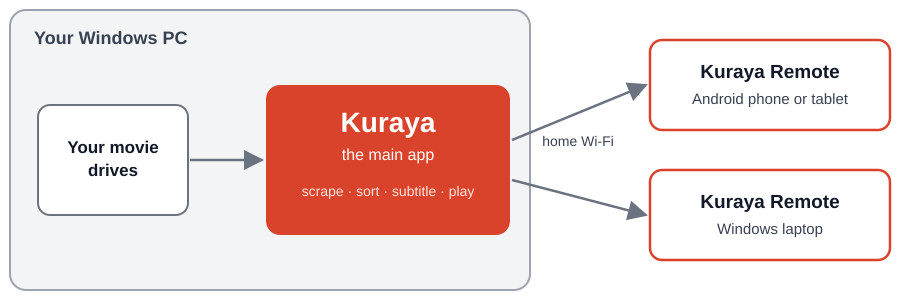

<p align="center">
  <picture>
    <source media="(prefers-color-scheme: light)" srcset="docs/kuraya_logo_light.png">
    
  </picture>
</p>
<h1 align="center">Kuraya 蔵屋</h1>
<p align="center"><b>Where Your Japanese Adult Movies Lives.</b></p>
<p align="center"><i>The JAV library that runs itself.</i></p>
<p align="center">
  <a href="https://github.com/Fetterbr61/Kuraya/releases"></a>
  <a href="https://github.com/Fetterbr61/Kuraya/releases"></a>
  
  
  
  <a href="https://paypal.me/supportkuraya"></a>
</p>

<p align="center"><b><a href="#download">Download</a></b> · <a href="https://fetterbr61.github.io/Kuraya/">Website</a> · <a href="HOW_KURAYA_WORKS.txt">User guide</a> · <a href="https://fetterbr61.github.io/Kuraya/buttons.html">What every button does</a> · <a href="https://fetterbr61.github.io/Kuraya/troubleshooting.html">Troubleshooting</a> · <a href="CHANGELOG.md">Changelog</a> · <a href="https://github.com/Fetterbr61/Kuraya/issues">Report a problem</a></p>

**Kuraya is a free Windows app that organises, subtitles and plays your own JAV collection.**

- Recognises a movie by the DVD-ID in its file name, and then fetches cover, title, cast, studio and genres from several sources.
- Sorts your library into clean folders and finds duplicates across your drives.
- Makes English subtitles from the audio, on your own PC.
- Plays your movies in one place, and streams them to your phone, tablet or laptop with the free Remote apps.

<a id="download"></a>

## ⬇️ Download: three apps, one library

Kuraya is **one main app on your Windows PC**, plus **two free remote apps** that stream your movies to your other devices. **You always need the main app. The remotes are optional.**

<table>
<tr>
<td width="33%" valign="top" align="center">
<h3>Kuraya</h3>
<b>The main app</b>
<p>Runs on your Windows 10/11 PC. For movies that have a DVD-ID in the file name, it fetches covers and info, sorts them into folders, finds duplicates and makes English subtitles. It also plays your movies. <b>Start here.</b></p>
<a href="https://github.com/Fetterbr61/Kuraya/releases/download/v2.0.5-beta.1/Kuraya-Setup-2.0.5-beta.1.exe"></a>
<br><sub>or the <a href="https://github.com/Fetterbr61/Kuraya/releases/download/v2.0.5-beta.1/Kuraya-2.0.5-beta.1-win64.zip">portable .zip</a> (no install)</sub>
</td>
<td width="33%" valign="top" align="center">
<h3>Kuraya Remote</h3>
<b>For Android</b>
<p>Streams your movies from the PC to your phone or tablet. Favourites and flags sync back to the PC.</p>
<a href="https://github.com/Fetterbr61/Kuraya/releases/download/v2.0.5-beta.1/Kuraya-Remote-2.0.5-beta.1.apk"></a>
<br><sub>APK file</sub>
</td>
<td width="33%" valign="top" align="center">
<h3>Kuraya Remote</h3>
<b>For Windows</b>
<p>The same remote for a laptop or a second PC. Unzip it anywhere and start <code>Kuraya_Remote.exe</code>. Nothing to install.</p>
<a href="https://github.com/Fetterbr61/Kuraya/releases/download/v2.0.5-beta.1/Kuraya-Remote-2.0.5-beta.1-win64.zip"></a>
<br><sub>zip file, keep the folder together</sub>
</td>
</tr>
</table>

<p align="center"></p>

**How to start:** 1) install **Kuraya** on the PC that holds your movies. 2) Install a **Remote** on the device where you want to watch. 3) In the remote, let it find your PC (or type its address and port 8080). The PC must be on with Kuraya running. All files in one place: [latest release](https://github.com/Fetterbr61/Kuraya/releases/latest).

<sub>Windows may warn about an unknown publisher the first time: choose *More info*, then *Run anyway*. Version 2.0.5-beta.1 is a test version (beta).</sub>

### What you need

- **Main app:** Windows 10 or 11 (64-bit). Setup helps you install the free helper tools, such as FFmpeg.
- **English subtitles from audio:** an NVIDIA graphics card helps a lot. Everything else works without one.
- **Remote apps:** the PC must be on with Kuraya running, and both devices on the same home network.

> [!IMPORTANT]
> **Every movie needs its DVD-ID in the file name**, the product code such as `ABP-112` or `SONE-804`. Kuraya recognises a movie only by that code. A file called `My Holiday Video.mp4` is not recognised, and Kuraya does not start any work on it.
>
> **Put new movies loose, not in a folder, into the Pre-Inbox or the Inbox.** Kuraya makes the movie's folder itself.
---
<!-- TESTERS-WANTED:START  (#1768: take out everything from here to TESTERS-WANTED:END when we have enough testers; the release notes copy this block automatically) -->
## 🧪 Beta testers wanted

Kuraya is in **beta**, and we are looking for a few people to try it on their own collection before the first stable release.

- **What you do:** install the latest **Setup** from [Releases](https://github.com/Fetterbr61/Kuraya/releases), use Kuraya with your own library for a week or two, and tell us what breaks, what is confusing and what is missing.
- **What you need:** a Windows 10/11 PC and a JAV collection (adults 18+ only). An NVIDIA graphics card helps for the subtitle features.
- **How to join:** [open a "Tester sign-up" issue](https://github.com/Fetterbr61/Kuraya/issues/new?title=Tester%20sign-up) and say roughly how many movies you have and which graphics card you use. Bugs and ideas go in [Issues](https://github.com/Fetterbr61/Kuraya/issues) too.

*This request will be taken down once we have enough testers.*
<!-- TESTERS-WANTED:END -->

---

## You don't have a collection problem. You have a *time* problem.

Thousands of files named `abp112.mp4`, `[HD]SONE-804-C.mkv`, `CD1`, `CD2`.
Half without covers. Japanese titles you can't read. Three copies of the same film on
three drives. No subtitles. And every tool you try does **one** of those jobs — then
leaves the other ten to you.

**Kuraya takes over the repetitive work.** For every movie that has its DVD-ID in the file name,
it identifies the film, fetches the cover, title, cast, studio and genres, translates them into English,
files it into a clean folder structure, finds duplicates and makes English subtitles from the audio.
It also plays your movies in one place. A movie file **without a DVD-ID in its name is not picked up**:
Kuraya does not start any work on it until the DVD-ID is in the name.

> Organisers show you what you have. **Kuraya does the repetitive work for you, once the DVD-ID is in the file name.**

---

## Why Kuraya and not the others

Most JAV tools fall into one of two camps: **scrapers** that fetch metadata, and
**media servers** that play it. Kuraya does both, and adds what neither offers.

| Capability | Scraper tools | Media servers | Kuraya |
|:---|:---:|:---:|:---|
| **Metadata** | | | |
| Identify films by DVD-ID; fetch metadata and covers | ✓ | ◐ | ✓ Several sources at once — you choose the best |
| Compare every source's result side by side | — | — | ✓ |
| English titles and series names | ◐ | — | ✓ Translated and saved with the film |
| Actress database with photos and bios | ◐ | ◐ | ✓ Multiple sources, one entry per actress |
| **Library** | | | |
| Rename and file into a clean folder structure | ✓ | — | ✓ Studio → genres → film, within Windows' path limit |
| Duplicate detection by ID, file content and audio | — | — | ✓ |
| Health checks, repairs and a recoverable trash | — | — | ✓ |
| Shrink large files to HEVC with verified picture and sound | — | — | ✓ |
| **Watching** | | | |
| Built-in player and cover browser | — | ✓ | ✓ |
| English subtitles generated from the audio | — | — | ✓ Whisper + AI translation, fully automatic |
| Stream your library to your phone | — | ✓ | ✓ Free Android and Windows remote |
| Browse and play any drive or network share | — | ◐ | ✓ Movies only, no clutter |
| **Proven** | | | |
| Used daily on a library of 20,000+ films | — | — | ✓ |

<sub>✓ yes · ◐ partly, or depends on plugins and setup · — no. Compared with typical tools in each category.</sub>

---

## What it feels like

### 🧠 It knows the films it can identify
Kuraya reads the DVD-ID out of even a messy file name (as long as the DVD-ID is in it), asks several movie
databases **at the same time**, and shows you every answer as a card: cover, title,
cast, genres. Take the best of each — or let automatic mode decide for a thousand films
while you sleep. Titles come back clean: no site watermarks, no junk tags, no 40-genre
soup (max 6, de-duplicated).

### 🗂️ It files your library like a librarian would
```
D:\Movies\Natural High\Dominant-Men\Molester\Office-Lady\Train\NHDTC-216\
```
Studio first, then **who is in control, what happens, to whom, and where**. Browse it
in Kuraya or straight in Explorer. Paths are kept under Windows' 255-character limit
automatically — long titles are shortened in file names, never lost.

### 🈶 It gives you English subtitles — from the audio
No subtitle on the internet? Kuraya transcribes the Japanese speech on your own
graphics card (Whisper, with a model tuned for this content) and translates it into
natural English, **locally on your own PC** (Ollama), so nothing about your movies leaves it. A real subtitle you already have is **never overwritten**, and a
failed one is never written — no empty files pretending to be done.

### 🎭 It knows the cast
A full actress database: photos and bios from several sources, duplicates removed,
aliases understood. Click a name, see every film she is in. An optional face check
(Media Tools) makes sure every photo really shows the right person and removes duplicates and covers.

### 🩺 It keeps itself healthy
A background guard checks your library in small steps while you use it: missing
covers, broken files, leftover junk, duplicate copies across drives. Safe fixes in one
click. Nothing is deleted without asking — and what is removed goes to a **quarantine**
first, so it can be put back.

### 💾 It saves you terabytes
Optional converter: re-encodes oversized files to HEVC, then **checks the length,
picture and sound** before it replaces anything. A result that is bigger, shorter or
silent is thrown away and the original kept.

### 📂 It plays anything, anywhere on your network
Not everything is in the library yet? The **Local & LAN browser** opens any drive or
network share and shows **only the movies** — no torrents, subtitles or installers in
the way. Sort, change the grid size and play straight away in Kuraya's own player.

### 📱 It comes with you
The free **Kuraya-Remote** app (Android and Windows) streams your own collection to any
phone, tablet or laptop in the house. Your files never leave your network.

---

## Your folders

Kuraya creates them for you inside its own folder on the first start — move any of them later in **Settings → Folders** (Kuraya offers to move the content along).

| Folder | What it is for |
|---|---|
| **Library** | Your finished, sorted collection: `Studio \ genres \ DVD-ID`. You can have several, on different drives. |
| **Pre-Inbox** | *Optional.* Where new downloads can land first. Kuraya joins multi-part files and asks about duplicates before any work, then moves the movie on to the Inbox and scrapes it by itself (see *Pre-Inbox or straight into the Inbox?* below). |
| **Inbox** | New movies waiting to be scraped. *Process Inbox* moves them into the library. |
| **Duplicates** | For DVD-IDs that clash: some **different** movies share the same DVD-ID (studios reuse codes). When the Inbox finds such a pair and you choose **Keep both**, Kuraya moves **both** into this folder, so neither overwrites the other or gets the other's cover, title or subtitle. Check them under *Source → Duplicates*, give each the right ID and scrape them again. |
| **Subtitle Queue** | Work folder for subtitles being made. |
| **Hardsub Extraction** | Drop a video with burned-in subtitles here to copy the text out into a subtitle file. |
| **Tools** | The free helper tools Setup downloads (FFmpeg, …). |

### Pre-Inbox or straight into the Inbox?

Both work - the Pre-Inbox is **optional**. With the default settings:

| | Pre-Inbox | Straight into the Inbox |
|---|---|---|
| Starts by itself when a download lands | yes | no |
| Loose file gets its own folder | yes | yes |
| Multi-part files (CD1/CD2) joined | yes | yes |
| Asks "do I already own this?" | yes | yes |
| ...before any work, while the other movies carry on | yes | no |
| Catches a movie you deleted before | yes | no |
| Checks the picture for mosaic, not only the file name | yes | no |
| Makes the English subtitle in the background | yes | yes |
| Checks for adverts and burned-in text in the background | yes | yes |
| Moves the movie on to the Inbox by itself | yes | no |
| Starts scraping by itself | yes | no |

**Why use the Pre-Inbox?** It is the hands-off way: you drop downloads in, and they come out scraped in the Inbox without pressing anything. Movies you already own wait for your answer **before** any work is spent on them, while the rest keeps going - so a big overnight batch never stalls on one duplicate. It also stops a movie you deleted on purpose from sneaking back, and its picture check gives a better censored/uncensored answer than the file name alone. Put files **straight into the Inbox** when you want to handle each step yourself.

Background work (subtitles, advert and burned-in text checks) runs while the **Auto** switch in the Task Console is on.
| **Browser extension** | Optional add-on for **Microsoft Edge** (or Chrome): it passes the Cloudflare "not a robot" check of the movie sites you visit to Kuraya, so scraping is faster and needs no FlareSolverr. Install: Setup → Tools → **Add to Edge** (or **Add to Chrome**). Kuraya opens the extensions page and copies the folder; switch on Developer mode, click **Load unpacked** and paste (Ctrl+V). Browsers only let you add an extension yourself. |

### Movies that are not in folders

Put new movies **loose** (not in a folder) into the **Pre-Inbox** or the **Inbox**: Kuraya makes the folder itself. Inside your library, Kuraya reads a movie only when it sits in **its own folder**, and every movie needs at least its **DVD-ID in the file name**. When **Scan Library** finds loose movie files in a library folder, it asks whether to move the ones with a DVD-ID to the **Pre-Inbox**. There Kuraya checks, scrapes, renames and files them by itself. Files without a DVD-ID stay where they are; put the DVD-ID in the name (for example `ABP-112.mp4`) and scan again. Nothing is overwritten.

```
Before (loose files)                 After Pre-Inbox + scraping
D:\Movies\                           D:\Movies\
  abp112.mp4                           ABP-112\
  abp112.srt                             ABP-112 <title> (<year>).mp4  (+ its .srt, cover, poster, .nmp)
  [HD]SONE-804-C.mkv                   SONE-804\  ...
  hhd800.com@IPX-177.mp4               IPX-177\   ...
  SSIS-001 CD1.mp4 + CD2.mp4           SSIS-001\  (you choose: join the parts, or keep them as Part 1 / Part 2)
  My Holiday Video.mp4                 My Holiday Video.mp4   <- no DVD-ID: stays, rename it first
```

Movies that are already in a folder, even one with an odd name, are read as they are. Right-click > **Check & Fix Names** shows what is not standard and fixes it after you agree.

---

## Something not working?

Try **[Troubleshooting](https://fetterbr61.github.io/Kuraya/troubleshooting.html)** first. Still stuck? In Kuraya click **Help → Report a problem** — it saves a log report on your Desktop and opens the problem page for you.

---

## Built on great free software

FFmpeg · FlareSolverr · Microsoft Edge (optional, with Kuraya's browser extension) · Ollama · Python · Subtitle Edit + Faster-Whisper · Chromaprint · czkawka · Tesseract · VideOCR · Flutter · media_kit/libmpv · ObjectBox.
Only **FFmpeg** is required — Kuraya's Setup offers the rest. Full list with what each is for and its licence:
**[Third-party tools](https://fetterbr61.github.io/Kuraya/third-party.html)**

---

## Your library stays yours

- **Local first.** Your files never leave your drives. No account, no cloud library.
- **No tracking.** Kuraya sends nothing to its developers — ever.
- **You choose the AI.** Local AI with Ollama on your own PC, or a cloud model only if
  *you* add a key. Movie lookups send just the DVD-ID.
- **Portable.** Everything Kuraya needs lives in its own folder. Delete the folder and
  it is gone. Nothing is installed into Windows.

---

## Get started in two minutes

1. Download **`Kuraya-Setup-<version>.exe`** from [Releases](../../releases) and run it.
   *(Windows may warn because the program is not signed: More info > Run anyway.)*
2. Updates: Kuraya tells you when a new version is out (or use **Help → Check for updates**) and installs it with one click — your settings, folders and library are kept.
   *(Prefer portable? Use the `-win64.zip` - see the guide.)*
3. The **Setup** window walks you through it: choose your movie folders, and let
   Kuraya download the free helper tools it needs (FFmpeg and friends) into its own
   folder.
4. Put your movie files **loose** (not in a folder) into the **Pre-Inbox** or the **Inbox**, with the DVD-ID in the file name. Kuraya makes the folder itself and does the rest.

> ### ⚠️ Every movie needs its DVD-ID in the file name
> Kuraya recognises a movie **only by its DVD-ID** (the product code, for example `ABP-112` or `SONE-804`).
> A file with a normal text name is **not recognised** — it is not scraped, not filed and not matched
> against what you already own. Look the ID up first and put it in the name:
>
> | File name | Result |
> |---|---|
> | `ABP-112.mp4`, `[HD]SONE-804-C.mkv`, `hhd800.com@IPX-177.mp4` | ✓ recognised (site tags and suffixes are ignored) |
> | `My Holiday Video.mp4`, `beach party 2019.mp4`, `new movie final.mkv` | ✗ not recognised — rename it with its DVD-ID, then scan again |
>
> Nothing is renamed or moved for you when there is no DVD-ID in the name.

The full guide is **[How Kuraya works](docs/how-kuraya-works.md)** (also
`HOW_KURAYA_WORKS.txt` inside the download). What changed in each version:
**[CHANGELOG](CHANGELOG.md)**.

**Requirements:** Windows 10/11 (64-bit). An NVIDIA graphics card is recommended for
subtitle making and fast conversion. Docker Desktop for sites behind Cloudflare.

---

## ❤ Support Kuraya

Kuraya is free, with no ads and no tracking. If it saves you hours of sorting,
renaming and subtitle hunting, a donation keeps it growing — new sources, better
subtitles, more fixes.

<p align="center"><a href="https://paypal.me/supportkuraya"></a></p>

**[paypal.me/supportkuraya](https://paypal.me/supportkuraya)** — any amount is appreciated. Thank you!

---

## Official links

- **Website and documentation:** <https://fetterbr61.github.io/Kuraya/>
- **GitHub (project page and downloads):** <https://github.com/Fetterbr61/Kuraya>
- **Download the latest version:** <https://github.com/Fetterbr61/Kuraya/releases/latest>

Kuraya has no other official website.

---

## Status

Kuraya is in **beta** — every main feature is in place and it has been tested on a
library of 20,000+ films, but you may meet bugs. Found one? Open an issue with the version number
(top of the log) and the file `Cashe\error_snapshot.txt`.

---

<p align="center"><sub>For adults (18+) only. Kuraya manages files you own; it does not
provide, host or download any video content.</sub></p>
